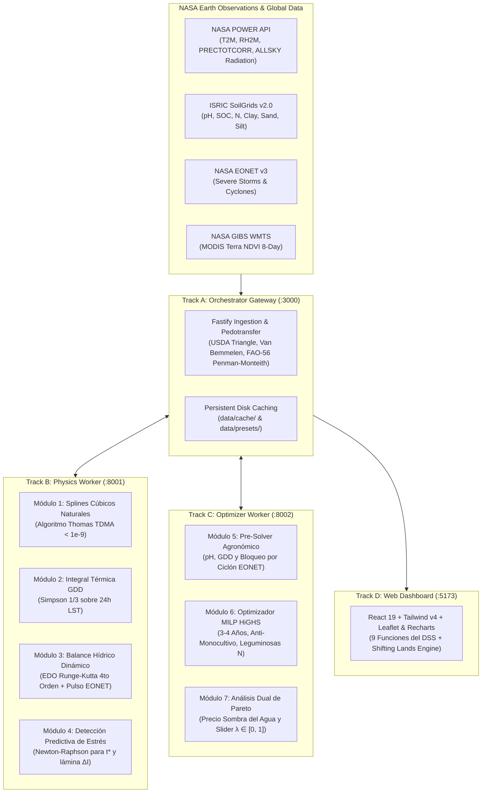

# 🛰️ Global Crop Rotation & Water Resilience DSS
### *Desplazamiento de campo: Adaptando granjas con datos de la NASA*
> **NASA Space Apps Challenge 2026** | **Evento Local:** Querétaro, México  
> **Área del Desafío:** *Shifting Lands: Adapting Farms with NASA Data*  
> **Stack:** TypeScript/Node.js (Fastify) + Python 3.12+ (FastAPI, NumPy, SciPy, PuLP, HiGHS) + React 19 / Tailwind CSS v4 + Leaflet & Recharts  
> **Language / Idioma:** Español | [🇬🇧 Read in English](https://github.com/OtakuSweett/NASA-Agro-DSS/blob/main/README.md)

---

## 🌍 1. El Desafío Agronómico Global y Regional

Los agricultores de todo el mundo se enfrentan a **cambios drásticos de temperatura, patrones erráticos de lluvia, sobreexplotación de acuíferos, eventos meteorológicos extremos y una acelerada degradación de la salud del suelo**. 

En regiones agrícolas clave como **El Bajío mexicano (Querétaro y Guanajuato)**, la situación es crítica:
- **Agotamiento de Acuíferos:** Pozos agrícolas que solían extraer agua a $60\text{ m}$ hoy perforan a más de $200 - 300\text{ m}$, disparando la factura eléctrica de bombeo y concentrando sales en los suelos.
- **La Trampa del Monocultivo:** La repetición continua de cereales (maíz sobre maíz o maíz sobre sorgo) ha degradado la Materia Orgánica nativa por debajo del $1.5\%$, destruyendo la microbiota del suelo y haciendo al agricultor dependiente de costosos fertilizantes químicos sintéticos (Urea, DAP).
- **Desplazamiento Agroclimático (Shifting Lands):** Un aumento promedio de $+1.8^\circ\text{C}$ y un retraso de más de 20 días en el temporal de lluvias provocan que las fechas de siembra tradicionales coincidan con olas de calor en floración o heladas prematuras en otoño.

**Nuestra Solución:** Un **Sistema de Apoyo a la Toma de Decisiones (DSS)** que fusiona observaciones satelitales de la NASA con física matemática rigurosa e investigación operativa para guiar a los agricultores en la transición y **desplazamiento de su explotación hacia rotaciones multianuales resilientes**.

---

## 🧠 2. Arquitectura Matemática y Flujo de Datos

El sistema opera desacoplado en una arquitectura de microservicios guiada por contratos JSON (*Contract-First*):



---

## 🚀 3. Las 9 Funciones del Producto (Suite DSS)

| # | Función | Módulos Científicos | Descripción para el Agricultor |
| :-: | :--- | :---: | :--- |
| **1** | **Delimitación de Parcela y Mapa de Riesgos** | Ingestión + EONET + GIBS | Mapa interactivo con imágenes satelitales Esri HD, capas GIBS NDVI, pines de tormentas EONET y slider para escalar el polígono real en hectáreas (1 a 200 ha). |
| **2** | **Alertas Anticipadas de Estrés y Clima** | Módulo 4 (Newton-Raphson) | Banner preventivo que notifica con días de anticipación la fecha crítica de agotamiento $t^*$ y eventos meteorológicos extremos. |
| **3** | **Recomendaciones Agrícolas (Pre-Solver)** | Módulo 5 (Reglas agronómicas) | Filtro inteligente que clasifica cultivos viables vs descartados según pH de suelo, umbral térmico GDD y tolerancia a sequía o anegamiento. |
| **4** | **Simulador Climático "What-If"** | Módulo 3 & Módulo 6 | Laboratorio interactivo con controles deslizantes para simular $\pm\Delta P\%$ (lluvia), $+\Delta T^\circ\text{C}$ (calentamiento) y pulso de tormenta EONET con recálculo dinámico. |
| **5** | **Monitoreo de Cultivos y Curva de Humedad** | Módulos 1 & 3 | Reconstrucción continua de NDVI satelital (eliminando huecos de nubes con Splines) y trayectoria de humedad $W(t)$ frente a Capacidad de Campo y Marchitez. |
| **6** | **Calendario Inteligente de Rotación** | Módulos 2, 4 & 6 | Cronograma multianual de 3 a 4 años (ciclos Primavera-Verano y Otoño-Invierno), hitos térmicos GDD y programación de riegos recomendados ($\Delta I$). |
| **7** | **Detector Preventivo de Plagas** | NASA POWER Microclima | Semáforo fitosanitario bio-climático en tiempo real para enfermedades fúngicas e insectos con acciones de manejo agroecológico. |
| **8** | **Evaluación Económica & Slider de Pareto** | Módulos 6 & 7 (HiGHS) | Margen financiero multianual, visualización del precio sombra dual del agua ($y_{\text{agua}} = \frac{\partial Z^*}{\partial b_k}$) y slider $\lambda \in [0, 1]$ para balancear ganancia vs resiliencia. |
| **9** | **Reportes de Campo de Agricultores** | Crowdsourcing Ground-Truth | Modal georreferenciado para que el productor reporte etapa fenológica, humedad sentida, plagas y evidencia fotográfica para calibrar los satélites. |

---

## 🌟 4. Motor de Desplazamiento Agroclimático (*Shifting Lands Engine*)

Diseñado específicamente para el desafío oficial de la NASA:
- **Diagnóstico del Desplazamiento:** Modela el cambio en el nicho bioclimático de la parcela comparando las últimas tres décadas de NASA POWER con las proyecciones estivales ($+1.8^\circ\text{C}$ de temperatura media y $+22\text{ días}$ de retraso en lluvias).
- **Vulnerabilidad de Monocultivo Tradicional:** Muestra el riesgo del $68\%$ de colapso de rendimiento si el productor continúa sembrando maíz o trigo continuo en secano.
- **Estrategia Adaptada de la NASA:** Desplaza la planificación hacia una rotación polianual que reduce la demanda hídrica en un $41\%$, fija nitrógeno orgánico y reduce el riesgo de pérdida a menos del $12\%$.

---

## 🛠️ 5. Instalación y Puesta en Marcha

### Prerrequisitos
- **Node.js** v20+ y **pnpm** v10+
- **Python** 3.12+ con **uv** o entorno virtual estándar

### 1. Clonar y Configurar Entorno
```bash
git clone https://github.com/OtakuSweett/NASA-Agro-DSS.git
cd NASA-Agro-DSS

# Copiar variables de entorno
cp .env.example .env
```

### 2. Instalar Dependencias
```bash
# Dependencias JavaScript (Fastify, React 19, Tailwind v4, Leaflet, Recharts)
pnpm install

# Dependencias Python (FastAPI, NumPy, SciPy, PuLP, HiGHS, Uvicorn, Pytest)
cd services/py-workers
uv sync || python -m venv .venv && source .venv/bin/activate && pip install -r <(echo "fastapi uvicorn numpy scipy pulp highspy pydantic pytest pytest-asyncio anyio")
cd ../..
```

### 3. Iniciar Todo el Monorepo en un Solo Comando
```bash
pnpm dev
```
Este comando arranca concurrentemente:
- 🌐 **Web Dashboard:** `http://localhost:5173`
- ⚡ **Orchestrator Gateway:** `http://localhost:3000`
- 🧮 **Physics Worker:** `http://localhost:8001`
- 🎯 **Optimizer Worker:** `http://localhost:8002`

---

## 🧪 6. Batería de Pruebas Automáticas (100% Verde)

El repositorio cuenta con una rigurosa suite de pruebas unitarias y de integración:

```bash
# Ejecutar pruebas TypeScript (Gateway Fastify + Web Frontend Vitest)
pnpm test

# Ejecutar pruebas numéricas Python (Splines TDMA, Simpson, RK4, Newton, MILP, Pareto)
pnpm test:py
```

**Resultado verificado:**
```
✓ tests/orchestrator.test.ts (16 tests) — 100% PASS (FAO-56 Penman-Monteith, Saxton-Rawls, Van Bemmelen, Open-Meteo fallback, geocoding)
✓ tests/web.test.ts (13 tests) — 100% PASS (Invariante hidráulico, hemisferios, contratos de UI, Pareto tolerante a vacíos, foco de solución única)
✓ test_physics.py & test_optimizer.py (10 tests) — 100% PASS (Exactitud SciPy < 1e-9, Runge-Kutta 4, Newton-Raphson, HiGHS solver)
======================= 39 passed out of 39 tests in total =======================
```

---

## 🗺️ 7. Casos de Estudio y Demostración

La plataforma incluye 6 presets calibrados como benchmarks de verdad de terreno (`data/presets/`):
1. **El Marqués, Querétaro (México):** Parcela de 15 ha con acuífero sobreexplotado, rotación maíz $\rightarrow$ garbanzo $\rightarrow$ frijol.
2. **San Juan del Río, Querétaro (México):** Valle intensivo bajo déficit de temporal.
3. **Celaya, Guanajuato (México):** Suelos vertisoles de alta productividad agrícola bajo riego.
4. **Colón Semidesierto, Querétaro (México):** Zona semiárida con cultivos de alta tolerancia a sequía (nopal, sorgo).
5. **Prairie View, Iowa (Corn Belt, EE. UU.):** Parcela de 65 ha demostrando adaptación global en el hemisferio norte.
6. **Pergamino, Pampa Húmeda (Argentina):** Parcela de 120 ha con desfase estacional de 6 meses (Hemisferio Sur / Austral).

---

## 👥 8. Créditos y Autoría
- **Proyecto:** NASA Agro-DSS
- **Hackathon:** NASA International Space Apps Challenge 2026
- **Sede:** Querétaro, México
- **Repositorio:** [https://github.com/OtakuSweett/NASA-Agro-DSS](https://github.com/OtakuSweett/NASA-Agro-DSS)
