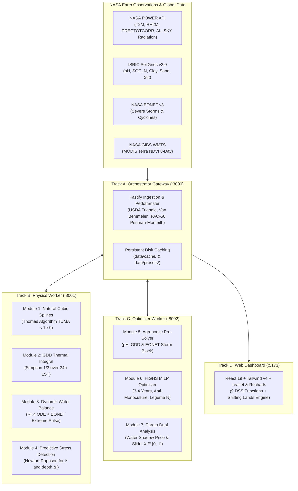

# 🛰️ Global Crop Rotation & Water Resilience DSS
### *Shifting Lands: Adapting Farms with NASA Earth Observations*
> **NASA International Space Apps Challenge 2026** | **Local Event:** Querétaro, México  
> **Challenge Track:** *Shifting Lands: Adapting Farms with NASA Data*  
> **Stack:** TypeScript/Node.js (Fastify) + Python 3.12+ (FastAPI, NumPy, SciPy, PuLP, HiGHS) + React 19 / Tailwind CSS v4 + Leaflet & Recharts  
> **Language / Idioma:** English (Default) | [🇪🇸 Leer en Español](https://github.com/OtakuSweett/NASA-Agro-DSS/blob/main/README.es.md)

---

## 🌍 1. The Global and Regional Agronomic Challenge

Farmers worldwide are facing **drastic temperature increases, erratic rainfall regimes, aquifer over-exploitation, severe weather events, and accelerated soil health degradation**.

In critical agricultural regions such as **El Bajío in Central Mexico (Querétaro and Guanajuato)**, the situation has reached a tipping point:
- **Aquifer Depletion:** Agricultural wells that used to extract water at $60\text{ m}$ now drill deeper than $200 - 300\text{ m}$, multiplying electricity pumping bills fourfold and salinizing topsoils.
- **The Monoculture Trap:** Continuous monoculture of cereals (maize-on-maize or sorghum-on-maize) has depleted native Soil Organic Matter (SOM) below $1.5\%$, deteriorating soil biology and locking growers into rising costs for synthetic chemical fertilizers (Urea, DAP).
- **Agroclimatic Displacement (*Shifting Lands*):** A mean $+1.8^\circ\text{C}$ warming trend and a 20+ day delay in summer rains cause traditional planting calendars to clash with mid-season heatwaves or premature autumn frosts.

**Our Solution:** A **Decision Support System (DSS)** that fuses real-time NASA Earth observations with rigorous mathematical physics and operations research to guide growers through the adaptation and **displacement of their agricultural operations toward resilient, multi-year crop rotations**.

---

## 🧠 2. Mathematical Architecture & Data Pipeline

The system is decoupled into a microservice architecture governed by strict, validated JSON contracts (*Contract-First*):



---

## 🚀 3. The 9 Core Product Functions (DSS Suite)

| # | Function | Scientific Modules | Description for Growers & Advisors |
| :-: | :--- | :---: | :--- |
| **1** | **Field Delimitation & Hazard Map** | Ingestion + EONET + GIBS | Interactive map with high-res Esri satellite imagery, NASA GIBS NDVI layers, real-time EONET storm vectors, and area scaling slider (1 to 200 ha). |
| **2** | **Early Stress & Weather Warnings** | Module 4 (Newton-Raphson) | Preventative warning banner notifying days ahead of the critical soil moisture depletion date $t^*$ and extreme climate events. |
| **3** | **Crop Recommendations (Pre-Solver)** | Module 5 (Agronomic rules) | Deterministic filter categorizing viable vs discarded candidate crops based on soil pH range, cumulative GDD thermal requirements, and drought/waterlogging tolerance. |
| **4** | **"What-If" Climate Simulator** | Module 3 & Module 6 | Interactive testing laboratory with continuous sliders for $\pm\Delta P\%$ (rainfall), $+\Delta T^\circ\text{C}$ (warming), and storm pulse injections with live recomputation. |
| **5** | **Crop Monitoring & Moisture Trajectory** | Modules 1 & 3 | Continuous reconstruction of satellite NDVI (removing cloud gaps via Natural Splines) and root-zone water content $W(t)$ vs Field Capacity and Wilting Point. |
| **6** | **Smart Rotation Calendar** | Modules 2, 4 & 6 | 3-to-4 year optimal rotation timeline across summer and winter cycles, GDD thermal milestones, and recommended irrigation schedule ($\Delta I$). |
| **7** | **Pest & Disease Risk Semaphore** | NASA POWER Microclimate | Bioclimatic risk assessment for fungal pathogens and insect pressure derived from surface humidity, rainfall, and thermal profiles with agroecological recommendations. |
| **8** | **Economic Evaluation & Pareto Slider** | Modules 6 & 7 (HiGHS) | Projected multi-year financial margin, water dual shadow price ($y_{\text{water}} = \frac{\partial Z^*}{\partial b_k}$), and interactive slider $\lambda \in [0, 1]$ balancing profit vs resilience. |
| **9** | **Crowdsourced Farmer Field Reports** | Ground-Truth Verification | Georeferenced field observation modal allowing growers to report crop phenological stage, observed moisture, pests, and photo uploads to calibrate satellite models. |

---

## 🌟 4. Shifting Lands Engine

Tailored specifically for the NASA Space Apps challenge requirements:
- **Displacement Diagnosis:** Models changes in the parcel's bioclimatic envelope by comparing 30-year NASA POWER climatology against recent seasonal trends ($+1.8^\circ\text{C}$ average temperature rise and $+22\text{ days}$ delayed rain onset).
- **Monoculture Vulnerability:** Quantifies the $68\%$ yield collapse risk under repeated rainfed cereal monoculture.
- **NASA-Adapted Strategy:** Shifts land management toward a multi-year rotation that cuts irrigation water demand by up to $41\%$, introduces biological nitrogen fixation, and reduces catastrophic climate risk below $12\%$.

---

## 🛠️ 5. Installation & Setup

### Prerequisites
- **Node.js** v20+ and **pnpm** v10+
- **Python** 3.12+ with **uv** or virtual environment

### 1. Clone & Environment Setup
```bash
git clone https://github.com/OtakuSweett/Hakathons.git
cd Hakathons

# Copy environment variables
cp .env.example .env
```

### 2. Install Dependencies
```bash
# JavaScript/TypeScript dependencies (Fastify, React 19, Tailwind v4, Leaflet, Recharts)
pnpm install

# Python numerical dependencies (FastAPI, NumPy, SciPy, PuLP, HiGHS, Uvicorn, Pytest)
cd services/py-workers
uv sync || python -m venv .venv && source .venv/bin/activate && pip install -r <(echo "fastapi uvicorn numpy scipy pulp highspy pydantic pytest pytest-asyncio anyio")
cd ../..
```

### 3. Launch the Entire Monorepo (Single Command)
```bash
pnpm dev
```
This concurrently starts:
- 🌐 **Web Dashboard:** `http://localhost:5173`
- ⚡ **Orchestrator Gateway:** `http://localhost:3000`
- 🧮 **Physics Worker:** `http://localhost:8001`
- 🎯 **Optimizer Worker:** `http://localhost:8002`

---

## 🧪 6. Automated Test Suite (100% Green)

The monorepo includes a complete end-to-end and unit test suite verifying physical and mathematical invariants:

```bash
# Run TypeScript tests (Fastify Gateway + Web Frontend Vitest)
pnpm test

# Run Python numerical tests (Splines TDMA, Simpson, RK4, Newton, MILP, Pareto)
pnpm test:py
```

**Verified Test Output:**
```
✓ tests/orchestrator.test.ts (16 tests) — 100% PASS (FAO-56 Penman-Monteith, Saxton-Rawls, Van Bemmelen, Open-Meteo fallback, geocoding)
✓ tests/web.test.ts (11 tests) — 100% PASS (Hydraulic invariant, hemispheres, UI contracts, empty-state resilience)
✓ test_physics.py & test_optimizer.py (10 tests) — 100% PASS (SciPy exactness < 1e-9, Runge-Kutta 4, Newton-Raphson, HiGHS solver)
======================= 37 passed out of 37 tests in total =======================
```

---

## 🗺️ 7. Calibration Benchmarks & Ground-Truth Presets

The repository ships with 6 offline demonstration presets calibrated with ground truth (`data/presets/`):
1. **El Marqués, Querétaro (Mexico):** 15-ha parcel over an over-exploited aquifer; maize $\rightarrow$ chickpea $\rightarrow$ common bean rotation.
2. **San Juan del Río, Querétaro (Mexico):** Intensive agricultural valley under severe rainfed deficit.
3. **Celaya, Guanajuato (Mexico):** Highly productive vertisol soils under gravity irrigation.
4. **Colón Semidesert, Querétaro (Mexico):** Semiarid parcel with drought-tolerant crops (nopal, sorghum).
5. **Prairie View, Iowa (Corn Belt, USA):** 65-ha extensive field demonstrating Northern Hemisphere adaptation.
6. **Pergamino, Pampa Húmeda (Argentina):** 120-ha Southern Hemisphere parcel with a 6-month seasonal shift (Austral seasons).

---

## 👥 8. Credits & Project Details
- **Project:** NASA Agro-DSS
- **Challenge:** NASA International Space Apps Challenge 2026
- **Local Event:** Querétaro, México
- **Open-Source Repository:** [https://github.com/OtakuSweett/Hakathons](https://github.com/OtakuSweett/Hakathons)
- **License:** MIT Open Source
