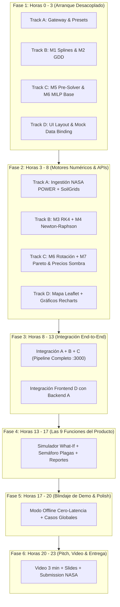

# Plan Maestro de Implementación — Sprint de 23 Horas
> **Proyecto:** NASA Space Apps 2026 — Global Crop Rotation & Water Resilience DSS  
> **Ventana de Tiempo:** 23 Horas restantes  
> **Estrategia:** Paralelismo estricto guiado por contratos (*Contract-First*), desacoplamiento total y contingencia de demo en vivo.

---

## 1. Visión Estratégica: Por qué este Monorepo permite ganar en 23h

Gracias a que los **contratos JSON (`packages/contracts/`)**, los **6 presets globales (`data/presets/`)** y las **especificaciones matemáticas (`AGENTS.md`)** ya están 100% listos y subidos a `main`, **ningún desarrollador tiene que esperar a otro para empezar a programar**:



---

## 2. Cronograma de Ejecución Hora por Hora (23h)

### ⏱ Bloque 1: Horas 0 a 3 — Arranque en Paralelo Aislado
*Objetivo:* Cada pista levanta su servicio localmente y cumple su primer commit sobre contratos.

| Pista | Responsable / Rama | Entregables Concretos |
| :--- | :--- | :--- |
| **Track A** | `feat/track-a-gateway` | - Servidor Fastify/Express en `:3000`.<br>- Ruta de fallback `GET /api/presets/:id` leyendo `data/presets/*.json`.<br>- Proxy hacia workers en `:8001` y `:8002`. |
| **Track B** | `feat/track-b-m1-m2` | - FastAPI en `:8001` (`POST /physics`).<br>- M1: Splines Cúbicos Naturales (`mod1_splines.py`) con algoritmo Thomas (TDMA).<br>- M2: Simpson 1/3 para GDD (`mod2_simpson.py`). Pruebas unitarias pasando. |
| **Track C** | `feat/track-c-m5-m6` | - FastAPI en `:8002` (`POST /optimize`).<br>- M5: Pre-Solver agronómico (`mod5_presolver.py`) con filtrado Pandas.<br>- M6: Esqueleto MILP con PuLP/HiGHS resolviendo un solo año. |
| **Track D** | `feat/track-d-shell` | - App React 19 + Tailwind v4 en `:5173`.<br>- Estructura de navegación para las 9 funciones.<br>- Consumo de `data/presets/el_marques.json` como mock inicial para renderizar componentes. |

---

### ⏱ Bloque 2: Horas 3 a 8 — Motores Numéricos y Conexión de Datos
*Objetivo:* Completar la física, la optimización multianual y la ingesta externa.

| Pista | Responsable / Rama | Entregables Concretos |
| :--- | :--- | :--- |
| **Track A** | `feat/track-a-ingestion` | - Cliente NASA POWER (horaria y diaria, radiación sin multiplicar por 3.6).<br>- Cliente ISRIC SoilGrids con cálculo de Van Bemmelen (%MO) y triángulo USDA.<br>- Ecuación FAO-56 Penman-Monteith con latitud dinámica.<br>- Validación `HTTP 422 NON_ARABLE_LAND` en tierra no agrícola.<br>- Caché persistente en `data/cache/`. |
| **Track B** | `feat/track-b-m3-m4` | - M3: EDO de Balance Hídrico con Runge-Kutta 4to Orden (`mod3_rk4.py`).<br>- Inyección de pulsos EONET de precipitación extraordinaria.<br>- M4: Newton-Raphson (`mod4_newton.py`) encontrando día crítico $t^*$ y lámina $\Delta I$.<br>- Endpoint `POST /physics` respondiendo con `physics.schema.json`. |
| **Track C** | `feat/track-c-m6-m7` | - M6: MILP multianual completo (3–4 años, anti-monocultivo, restricción de leguminosas fijadoras de N, holgura de agua $s_t^+$).<br>- M7: Frontera de Pareto dual (`mod7_pareto.py`) calculando precios sombra del agua ($y_{\text{agua}}$) y barrido $\lambda \in [0, 1]$.<br>- Endpoint `POST /optimize` respondiendo con `optimizer.schema.json`. |
| **Track D** | `feat/track-d-viz` | - Mapa Leaflet interactivo mundial con capas NASA GIBS WMTS.<br>- Gráfica Recharts de NDVI (serie MODIS cruda vs. spline continua M1).<br>- Gráfica de trayectoria del agua en el suelo $W(t)$ con línea de umbral crítico $W_{\text{crítico}}$. |

---

### ⏱ Bloque 3: Horas 8 a 13 — Integración End-to-End
*Objetivo:* Unir los microservicios en un único flujo funcional continuo.

1. **Hito de Integración Backend (Hora 10):**
   - El orquestador (:3000) recibe `POST /api/analyze`, consulta APIs en vivo, preprocesa suelo/clima, despacha a `:8001` (Física) y con sus salidas alimenta a `:8002` (Optimización).
   - Verificación de tiempo de respuesta: $< 3.5\text{ s}$ con APIs en vivo, $< 50\text{ ms}$ con presets/caché.
2. **Hito de Integración Full-Stack (Hora 12):**
   - El frontend se conecta a `:3000`. Al hacer clic en el mapa (o seleccionar Iowa, Pergamino o El Marqués), la app ejecuta todo el pipeline y actualiza todas las vistas en tiempo real.
3. **Pull Request y Merge a `main`:**
   - Squash-merge de las 4 ramas hacia `main` tras verificar `pnpm test` y `pytest`.

---

### ⏱ Bloque 4: Horas 13 a 17 — Las 9 Funciones del Producto y Experiencia UX
*Objetivo:* Completar el catálogo de valor que evalúan los jueces de la NASA.

1. **Simulador Climático "What-If" (Función 4):**
   - Sliders de $\pm\Delta P$ (lluvia), $+\Delta T$ (temperatura) e inyección manual de huracán EONET con recálculo dinámico.
2. **Calendario Inteligente de Rotación (Función 6):**
   - Timeline visual de 3 a 4 años mostrando fechas óptimas de siembra, germinación, floración y riegos recomendados.
3. **Semáforo Fitosanitario de Plagas (Función 7):**
   - Cálculo automático de riesgo de roya, tizón y gusano cogollero según humedad relativa $\ge 80\%$ y temperatura.
4. **Evaluación Económica & Slider de Pareto (Función 8):**
   - Desglose de ingresos vs. costos de fertilizante/agua, display del precio sombra del agua ($y_{\text{agua}}$ en \$/m³) y slider interactivo $\lambda \in [0, 1]$.
5. **Reportes de Campo de Agricultores (Función 9):**
   - Modal georreferenciado para capturar observaciones de campo y fotos de validación satelital.

---

### ⏱ Bloque 5: Horas 17 a 20 — Blindaje de Demo & Polish Visual
*Objetivo:* Garantizar que la demostración sea imposible de romper en vivo.

> [!IMPORTANT]
> **Regla de Oro de Demostración:** Jamás dependas al 100% del internet del lugar del evento durante la presentación ante el jurado.
> - Se implementa un interruptor visible **"Modo Live API / Modo Offline Benchmark"**.
> - Si las APIs de la NASA o SoilGrids tardan más de 4 segundos o fallan, el sistema conmuta suavemente al preset más cercano (`el_marques`, `iowa_us`, `pampa_argentina`) sin mostrar pantallas de error.

- **Pruebas de Casos Extremos:**
  - Clic en el océano Atlántico $\rightarrow$ Mensaje amigable: `"NON_ARABLE_LAND: Please select agricultural parcel"`.
  - Clic en Argentina (Hemisferio Sur) $\rightarrow$ Verificación de que la siembra se sincroniza al verano austral.
- **Bilingüismo (EN/ES):** Toggle de idioma en el header que traduce toda la interfaz al instante.
- **Diseño Responsive:** Ajuste limpio para laptop de jurados y proyector.

---

### ⏱ Bloque 6: Horas 20 a 23 — Pitch, Video y Submission NASA
*Objetivo:* La presentación vende el proyecto; el código respalda la victoria.

1. **Grabación de Video de 3 Minutos (Horas 20 a 21.5):**
   - **0:00 - 0:40 (El Problema Global):** Agricultores enfrentando sequías, acuíferos agotados y degradación del suelo.
   - **0:40 - 1:20 (La Solución NASA Agro-DSS):** Ingesta satelital global (NASA POWER + SoilGrids + EONET + GIBS) combinada con física rigurosa (RK4 + Splines) y optimización matemática (MILP HiGHS + Pareto).
   - **1:20 - 2:20 (Demo en Vivo):** 
     - Caso 1: Parcela en El Bajío, México con rotación maíz-brócoli-garbanzo y alerta de estrés hídrico $t^*$.
     - Caso 2: Parcela en Iowa, EE.UU. demostrando cobertura planetaria y adaptación climática.
     - Simulación "What-If" inyectando $+2^\circ\text{C}$ de cambio climático y viendo la respuesta del cultivo.
   - **2:20 - 3:00 (Impacto Económico y Sostenibilidad):** Ahorro de agua en m³, regeneración de nitrógeno del suelo y viabilidad para el agricultor.
2. **Documentación Final y Repositorio (Horas 21.5 a 22.5):**
   - README.md con capturas de pantalla, badges de tests, diagrama de arquitectura y comandos de arranque (`pnpm dev`, `uv run`).
3. **Submission en Portal de la NASA (Hora 22.5 a 23.0):**
   - Carga de enlace de GitHub, video de YouTube, resumen del proyecto y créditos del equipo.

---

## 3. Matriz de Responsabilidades y Asignación del Equipo

| Miembro / Rol | Pista Principal | Responsabilidades Críticas |
| :--- | :---: | :--- |
| **Dev 1 (Backend & Ingestión)** | **Track A** | Orquestador Fastify/TS, APIs NASA POWER/SoilGrids, Penman-Monteith, EONET pulse, caché. |
| **Dev 2 (Física Numérica)** | **Track B** | Microservicio `:8001`, M1 Splines TDMA, M2 GDD Simpson, M3 RK4 EDO, M4 Newton-Raphson. |
| **Dev 3 (Investigación Operativa)** | **Track C** | Microservicio `:8002`, M5 Pre-solver, M6 MILP HiGHS rotación 3-4 años, M7 Pareto y precios sombra. |
| **Dev 4 (Frontend Lead & UX)** | **Track D** | App React 19, Leaflet GIBS/EONET, Recharts, simulador What-If, slider de Pareto, EN/ES. |
| **Lead / DevOps (Tú)** | **Coordinador** | Integración en `main`, revisión de contratos, control de branches, soporte cruzado y pitch/video. |

---

## 4. Comandos de Verificación Rápida para el Equipo

- **Track A (Node.js/TS):**
  ```bash
  pnpm --filter orchestrator test
  pnpm --filter orchestrator dev
  ```
- **Tracks B y C (Python):**
  ```bash
  cd services/py-workers
  uv run pytest
  uv run uvicorn physics_worker.main:app --port 8001 --reload
  uv run uvicorn optimizer_worker.main:app --port 8002 --reload
  ```
- **Track D (React):**
  ```bash
  pnpm --filter web dev
  ```
- **Arranque Monorepo Completo:**
  ```bash
  pnpm dev
  ```
